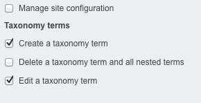

# Creating and using taxonomies

## In this section

- Taxonomy usage
- Terms and types
- Creating a taxonomy
- Reordering terms
- Removing terms and types
- Permissions

## Before we begin

- Make sure you have the Silverstripe [taxonomy](http://addons.silverstripe.org/add-ons/silverstripe/taxonomy) module installed

## Taxonomy usage

This module provides a raw skeleton for maintaining taxonomies in the CMS. Taxonomies are used to group content, making it easy to find related pieces of information. By default, the module provides the screens described below to create and manage taxonomies, using terms and types.

### Terms and types

A term is one entry in a taxonomy. Terms form a tree. A term at the top of the tree is the root of a taxonomy, and it can have any number of child terms, which can have child terms of their own. For example, a term called "News" could have the child terms "National", "International" and "Sport".

A type is a label for a whole taxonomy, for example "Content category". The type of a top-level term applies to all the terms below it, so child terms have no type field of their own.

The "Taxonomies" section has two tabs, "Terms" and "Types". You only see the tabs that you have access to. Only administrators can add, change or delete types.

### Creating a taxonomy

1. Go to the "Taxonomies" section.
1. If you want to give the taxonomy a type, select the "Types" tab, select "Add type", enter a name and select "Save". An administrator must do this step.
1. Select the "Terms" tab, then select "Add term". Enter the name, choose a type if you want one, and select "Save". The new term opens for editing.
1. Select "Add child term" below the form to add a term inside the one that you are editing. For example, add "National" to "News". Open "National" and add "Weather" to it. You have now created a three-level tree, "News > National > Weather".

The breadcrumbs at the top of the screen show where a term sits in the tree. Select a part of the trail to go to that term, or select "Taxonomy terms" to go back to the list.

To find a top-level term, type part of its name into the search box above the list. The list shows 50 terms at a time, and has links to the other pages.

### Reordering terms

Terms appear in the order you give them. There are three ways to move a term among the terms at the same level:

- Drag the row by its handle.
- Focus the handle with the keyboard, press the space bar or enter to pick the row up, use the up and down arrow keys to move it, and press the space bar or enter to drop it. Press escape to cancel.
- Select "Move up" or "Move down" in the row.

The new order is saved at once. If the CMS cannot save it, the list goes back to the old order and shows an error message. You cannot reorder the top-level list while a search is filtering it.

You cannot move a term to a different parent. Create the term in the right place instead.

### Removing terms and types

To remove a term, select "Delete" in the list or on the edit screen, and confirm. This also removes all the terms nested under it, so the confirmation message says so when the term has children. You cannot undo a deletion.

To remove a type, open the "Types" tab and use "Delete" in the same way.

### What the section no longer offers

Earlier versions of the module offered CSV import, CSV export, printing, previous and next record links, and search filters other than the name. The screen no longer has them.

## Permissions

Site administrator can specify permissions around taxonomies. A group needs access to the "Taxonomies" section to see the screen. There are three more permissions that can be set on groups:

- "Create a taxonomy term": allows adding new terms to existing taxonomies.
- "Delete a taxonomy term and all nested terms": allows to delete items recursively.
- "Edit a taxonomy term": allows members of the group to update the taxonomy details.

Members with access to the section can see all the types, but only administrators can change them.
